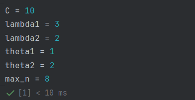
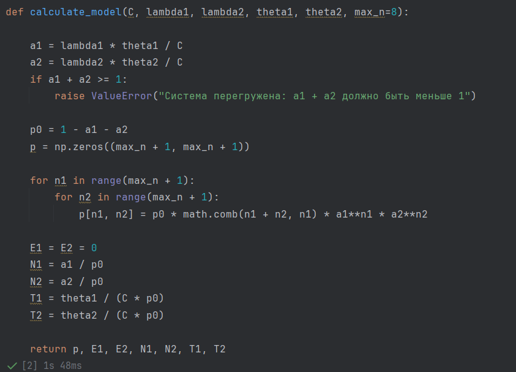
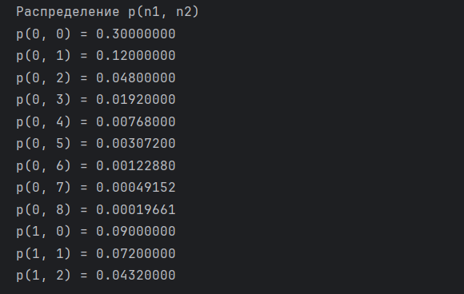
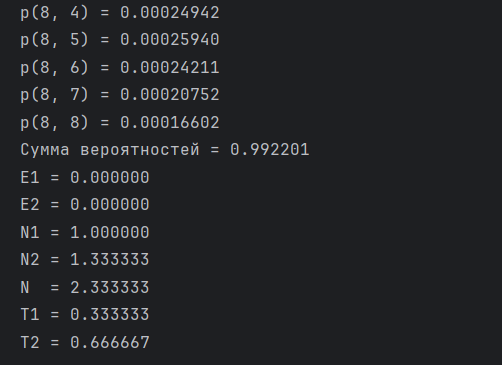
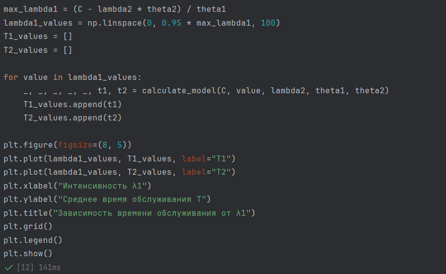
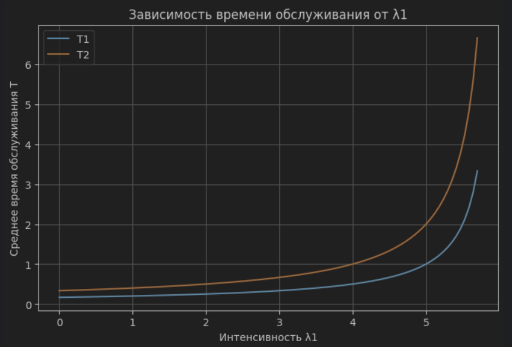
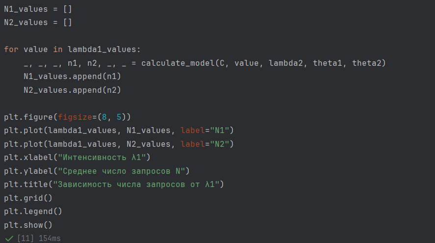
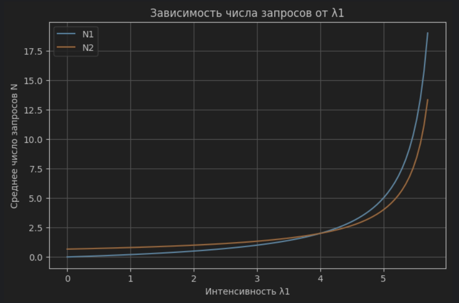

# Задание 1

## 1. Алгоритм расчета вероятностных характеристик модели

**Шаг 1: Ввод исходных данных**

$C$ — пиковая пропускная способность системы;

$\lambda_1$, $\lambda_2$ — интенсивности поступления запросов первого и второго типов;

$\theta_1$, $\theta_2$ — средние размеры передаваемых файлов;

$n_1$, $n_2$ — число одновременно обслуживаемых запросов каждого типа.

**Шаг 2: Расчет интенсивностей предложенной нагрузки**

$$
\rho_1=\lambda_1\theta_1, \qquad \rho_2=\lambda_2\theta_2.
$$

Определяем доли нагрузки, приходящиеся на единицу пропускной способности:

$$
a_1=\frac{\rho_1}{C}, \qquad a_2=\frac{\rho_2}{C}.
$$

Для существования стационарного распределения необходимо выполнение условия:

$$
a_1+a_2<1.
$$

**Шаг 3: Расчет вероятности нулевого состояния**

Из условия нормировки распределения получаем:

$$
p(0,0)=1-a_1-a_2.
$$

**Шаг 4: Расчет стационарного распределения вероятностей**

Для состояния $(n_1,n_2)$ вероятность определяется по формуле:

$$
p(n_1,n_2)=\frac{(n_1+n_2)!}{n_1!n_2!}\,a_1^{n_1}a_2^{n_2}p(0,0).
$$

В программе выводится таблица состояний при $n_1,n_2=0,1,\ldots,8$. Остальные состояния в таблице не показаны, поскольку число запросов в модели не ограничено.

**Шаг 5: Расчет вероятностей блокировки**

В модели с эластичным трафиком запросы обоих типов принимаются в систему без блокировки:

$$
E_1=E_2=0.
$$

**Шаг 6: Расчет среднего числа запросов**

Среднее число обслуживаемых запросов каждого типа:

$$
N_1=\frac{a_1}{1-a_1-a_2},
\qquad
N_2=\frac{a_2}{1-a_1-a_2}.
$$

Общее среднее число запросов:

$$
N=N_1+N_2.
$$

**Шаг 7: Расчет среднего времени обслуживания**

По формуле Литтла:

$$
T_1=\frac{N_1}{\lambda_1},
\qquad
T_2=\frac{N_2}{\lambda_2}.
$$

После подстановки выражений для $N_1$ и $N_2$:

$$
T_1=\frac{\theta_1}{C(1-a_1-a_2)},
\qquad
T_2=\frac{\theta_2}{C(1-a_1-a_2)}.
$$

При нулевой интенсивности какого-либо типа среднее время определяется по последней формуле как предельное значение.

# Задание 2

Программа реализует расчет вероятностных характеристик двухсервисной модели с эластичным трафиком. Для заданных исходных параметров рассчитываются доли нагрузки $a_1$ и $a_2$, стационарные вероятности состояний $p(n_1,n_2)$, вероятности блокировки $E_1$ и $E_2$, среднее число запросов $N_1$ и $N_2$, а также среднее время обслуживания $T_1$ и $T_2$.

В программе используются следующие исходные данные:

$$
C=10, \qquad \lambda_1=3, \qquad \lambda_2=2,
$$

$$
\theta_1=1, \qquad \theta_2=2, \qquad n_{\max}=8.
$$

{#fig-001 width=70%}

Основные расчеты выполняются в функции `calculate_model`. Сначала определяются нагрузки $a_1$ и $a_2$ и проверяется условие устойчивости $a_1+a_2<1$. Если оно не выполняется, программа сообщает о перегрузке системы. Затем находится вероятность пустого состояния $p(0,0)$, создается матрица `p` и с помощью двух вложенных циклов рассчитываются вероятности состояний от $(0,0)$ до $(8,8)$. В конце функция определяет $E_1$, $E_2$, $N_1$, $N_2$, $T_1$ и $T_2$.

{#fig-002 width=85%}

После вызова функции программа выводит вероятности состояний **по отдельности**, в виде `p(n1, n2) = значение`. Циклы перебирают значения $n_1$ и $n_2$ от 0 до 8 включительно, поэтому всего выводится $9\cdot9=81$ вероятность. Для удобства значения показываются с восемью знаками после запятой.

{#fig-003 width=75%}

В конце вывода программа показывает сумму рассчитанных вероятностей, вероятности блокировки, среднее число запросов и среднее время обслуживания каждого типа.

{#fig-004 width=75%}

Для заданных исходных данных получены следующие нагрузки:

$$
a_1=\frac{3\cdot1}{10}=0.3,
\qquad
a_2=\frac{2\cdot2}{10}=0.4.
$$

Условие устойчивости выполняется: $0.3+0.4=0.7<1$. Вероятность пустой системы:

$$
p(0,0)=1-0.3-0.4=0.3.
$$

**1. Распределение вероятностей.** Например, получены значения $p(0,0)=0.30000000$, $p(0,1)=0.12000000$, $p(1,0)=0.09000000$ и $p(1,1)=0.07200000$. Вероятность каждого состояния определяется числом находящихся в системе запросов обоих типов. Сумма 81 показанной вероятности составляет $0.992201$. Она меньше единицы, так как при $n_{\max}=8$ в вывод не входят состояния с $n_1>8$ или $n_2>8$. Полное распределение по всем возможным состояниям нормировано на 1.

**2. Вероятности блокировки.** Получено $E_1=E_2=0$. Новые запросы не блокируются, но при увеличении числа активных запросов скорость передачи данных каждого из них уменьшается.

**3. Среднее число запросов.** Результаты расчета:

$$
N_1=1.000000, \qquad N_2=1.333333,
$$

$$
N=N_1+N_2=2.333333.
$$

Таким образом, в системе одновременно обслуживается в среднем около 2.33 запроса.

**4. Среднее время обслуживания.** Получены значения:

$$
T_1=0.333333, \qquad T_2=0.666667.
$$

Среднее время обслуживания запроса второго типа в два раза больше, поскольку его средний размер файла в два раза больше при использовании общего ресурса сети.

# Задание 3

Для построения зависимости среднего времени обслуживания от интенсивности поступления запросов первого типа программа изменяет $\lambda_1$, оставляя параметры $C$, $\lambda_2$, $\theta_1$ и $\theta_2$ постоянными.

Сначала из условия устойчивости определяется предельная интенсивность:

$$
\lambda_1<\frac{C-\lambda_2\theta_2}{\theta_1}
=\frac{10-2\cdot2}{1}=6.
$$

В коде эта граница сохраняется в переменной `max_lambda1`. Для графика выбираются 100 равномерно расположенных значений от 0 до $0.95\cdot6=5.7$ с помощью `np.linspace`. Коэффициент 0.95 позволяет приблизиться к границе устойчивости, не достигая ее.

Для каждого значения $\lambda_1$ вызывается функция `calculate_model`. Полученные значения $T_1$ и $T_2$ добавляются в списки `T1_values` и `T2_values`, которые используются для построения двух кривых.

{#fig-005 width=85%}

{#fig-006 width=80%}

С увеличением интенсивности $\lambda_1$ среднее время обслуживания запросов обоих типов растет. Это связано с тем, что все активные запросы делят общую пропускную способность системы. При приближении нагрузки к предельной время обслуживания увеличивается особенно быстро. Значение $T_2$ выше $T_1$, так как $\theta_2=2\theta_1$.

# Задание 4

Для исследования зависимости среднего числа обслуживаемых запросов от интенсивности поступления запросов первого типа используется **тот же массив** `lambda1_values`, содержащий 100 значений $\lambda_1$ от 0 до 5.7. Остальные параметры модели остаются постоянными.

В цикле для каждого значения $\lambda_1$ повторно вызывается `calculate_model`. Из результатов выбираются средние числа запросов $N_1$ и $N_2$, которые сохраняются в списках `N1_values` и `N2_values` для построения графика.

{#fig-007 width=85%}

{#fig-008 width=80%}

По графику видно, что при увеличении $\lambda_1$ растут средние числа запросов обоих типов. Значение $N_1$ увеличивается вследствие роста интенсивности поступления запросов первого типа и времени их обслуживания. При этом $N_2$ также растет, хотя $\lambda_2$ остается постоянной, поскольку из-за общей нагрузки запросы второго типа находятся в системе дольше. В отличие от модели с ограниченным числом каналов, здесь количество одновременно обслуживаемых запросов теоретически не ограничено.

# Вывод

В ходе лабораторной работы была исследована двухсервисная модель с эластичным трафиком. Рассчитаны стационарное распределение вероятностей состояний, вероятности блокировки запросов каждого типа, среднее число обслуживаемых запросов и среднее время обслуживания.

Для выбранных параметров вероятности блокировки обоих типов равны нулю, общее среднее число запросов составляет $N=2.333333$, а среднее время обслуживания равно $T_1=0.333333$ и $T_2=0.666667$.

Построенные графики показывают, что при увеличении интенсивности поступления запросов первого типа растут как среднее время обслуживания, так и среднее число запросов обоих типов. При приближении суммарной нагрузки к пропускной способности системы эти характеристики увеличиваются особенно быстро.
