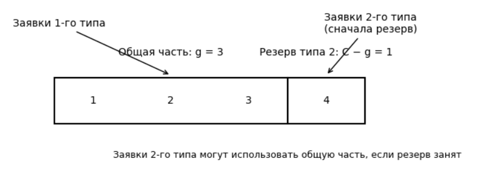
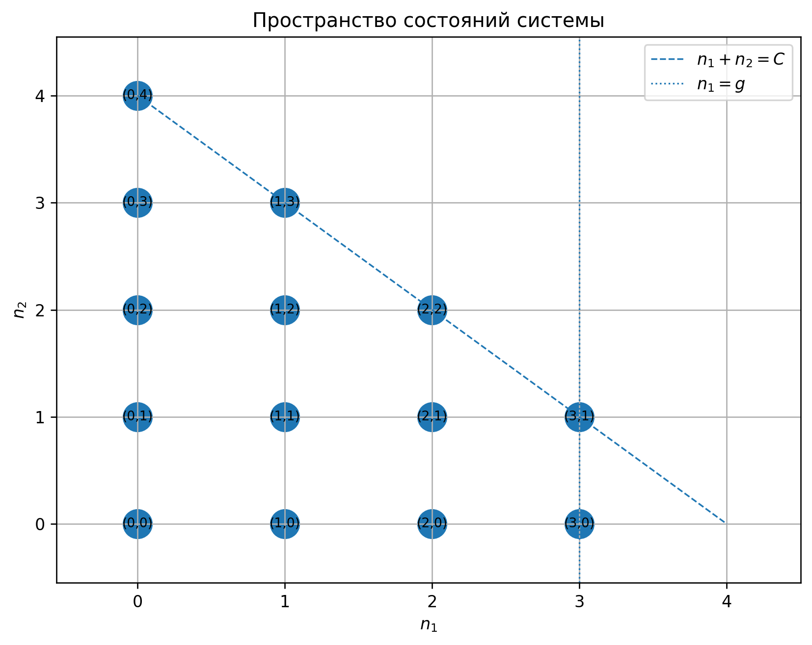
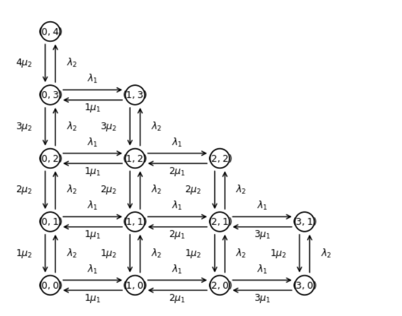
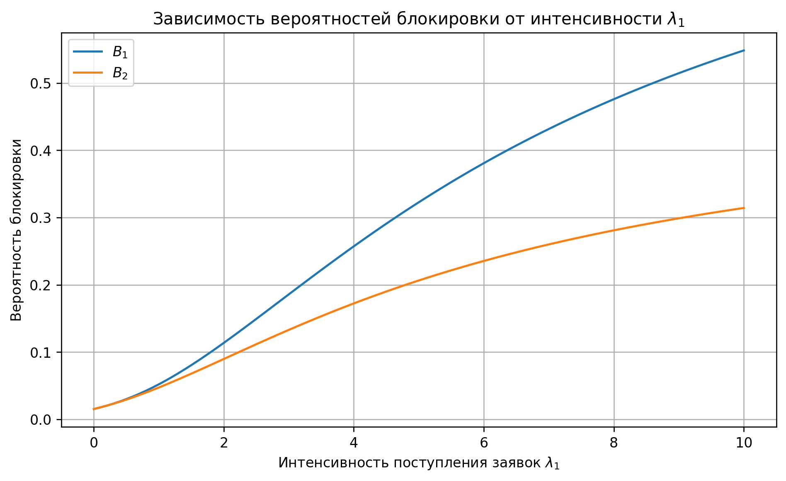
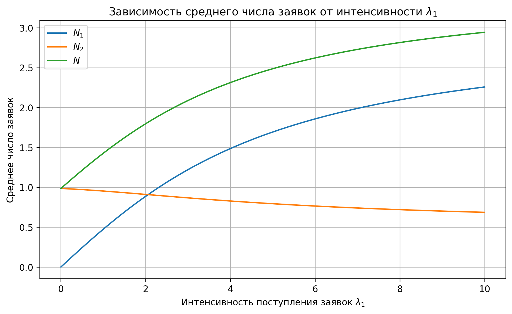

# Задание 1

## 1. Описание модели

Рассматривается неполнодоступная двухсервисная модель Эрланга с общей емкостью $C$. В систему поступают заявки двух типов. Потоки заявок независимы и имеют пуассоновские интенсивности $\lambda_1$ и $\lambda_2$. Время обслуживания заявок первого и второго типов распределено по экспоненциальному закону с интенсивностями $\mu_1$ и $\mu_2$ соответственно.

Из $C$ приборов $g$ образуют общую часть, доступную заявкам обоих типов, а $C-g$ приборов зарезервированы для заявок второго типа. Заявки второго типа в первую очередь занимают резерв; если он уже занят, они могут использовать свободные приборы общей части. Заявки первого типа используют только общую часть, поэтому их число не может превышать $g$. Таким образом, заявки второго типа могут занимать любые из $C$ приборов, а заявки первого типа — только приборы общей части.

Состояние системы задается парой $(n_1,n_2)$, где $n_1$ и $n_2$ — количество обслуживаемых заявок первого и второго типов.

Интенсивности предложенной нагрузки:

$$
\rho_1=\frac{\lambda_1}{\mu_1},
\qquad
\rho_2=\frac{\lambda_2}{\mu_2}.
$$

В расчетах используются параметры из примера методических указаний:

$$
C=4,\qquad g=3,\qquad
\lambda_1=1,\qquad \lambda_2=1,
$$

$$
\mu_1=2,\qquad \mu_2=1.
$$

Следовательно, количество зарезервированных приборов составляет $C-g=1$, а интенсивности предложенной нагрузки равны $\rho_1=0.5$ и $\rho_2=1$.

## 2. Схема модели

На рисунке показано распределение приборов при $C=4$ и $g=3$. Первые три прибора доступны заявкам первого типа, а четвертый прибор образует резерв для заявок второго типа. Заявки второго типа могут использовать всю емкость системы.

{#fig-001 width=85%}

## 3. Пространство состояний

Пространство состояний определяется ограничениями на количество обслуживаемых заявок:

$$
X=\left\{(n_1,n_2):
0\leq n_1\leq g,\;
n_2\geq0,\;
n_1+n_2\leq C
\right\}.
$$

Для заданных параметров $C=4$ и $g=3$ получаем:

$$
\begin{aligned}
X=\{&(0,0),(1,0),(2,0),(3,0),\\
&(0,1),(1,1),(2,1),(3,1),\\
&(0,2),(1,2),(2,2),\\
&(0,3),(1,3),(0,4)\}.
\end{aligned}
$$

Таким образом, количество состояний системы равно $|X|=14$.

{#fig-002 width=75%}

## 4. Диаграмма интенсивностей переходов

Из состояния $(n_1,n_2)$ возможны следующие переходы:

- поступление заявки первого типа: $(n_1,n_2)\rightarrow(n_1+1,n_2)$ с интенсивностью $\lambda_1$, если $n_1<g$ и $n_1+n_2<C$;
- поступление заявки второго типа: $(n_1,n_2)\rightarrow(n_1,n_2+1)$ с интенсивностью $\lambda_2$, если $n_1+n_2<C$;
- завершение обслуживания заявки первого типа: $(n_1,n_2)\rightarrow(n_1-1,n_2)$ с интенсивностью $n_1\mu_1$, если $n_1>0$;
- завершение обслуживания заявки второго типа: $(n_1,n_2)\rightarrow(n_1,n_2-1)$ с интенсивностью $n_2\mu_2$, если $n_2>0$.

На диаграмме горизонтальные переходы соответствуют поступлению и завершению обслуживания заявок первого типа: интенсивности поступления равны $\lambda_1$, а интенсивности обратных переходов — $n_1\mu_1$. Вертикальные переходы соответствуют заявкам второго типа: интенсивности поступления равны $\lambda_2$, а интенсивности обратных переходов — $n_2\mu_2$. Переходы поступления существуют только тогда, когда соответствующая заявка может быть принята системой.

{#fig-003 width=85%}

## 5. Множества блокировок и приема

Заявка первого типа блокируется, если достигнуто ограничение $n_1=g$ или заняты все приборы системы. Поэтому:

$$
B_1=\{(n_1,n_2)\in X:
n_1=g\ \lor\ n_1+n_2=C\}.
$$

Для выбранных параметров:

$$
B_1=\{(3,0),(3,1),(2,2),(1,3),(0,4)\}.
$$

Заявка второго типа блокируется только при полной занятости системы:

$$
B_2=\{(n_1,n_2)\in X:n_1+n_2=C\}.
$$

$$
B_2=\{(0,4),(1,3),(2,2),(3,1)\}.
$$

Множества приема являются дополнениями множеств блокировок в пространстве состояний:

$$
S_1=X\setminus B_1
=\{(n_1,n_2)\in X:n_1<g,\ n_1+n_2<C\},
$$

$$
S_1=\{(0,0),(1,0),(2,0),(0,1),(1,1),
(2,1),(0,2),(1,2),(0,3)\}.
$$

Для заявок второго типа:

$$
S_2=X\setminus B_2
=\{(n_1,n_2)\in X:n_1+n_2<C\}.
$$

$$
\begin{aligned}
S_2=\{&(0,0),(1,0),(2,0),(3,0),\\
&(0,1),(1,1),(2,1),\\
&(0,2),(1,2),(0,3)\}.
\end{aligned}
$$

## 6. Система уравнений глобального баланса (СУГБ)

Для произвольного состояния $(n_1,n_2)\in X$ сумма интенсивностей переходов из состояния равна сумме интенсивностей переходов в него.

Введем индикатор:

$$
I\{A\}=
\begin{cases}
1,& \text{если условие }A\text{ выполняется},\\
0,& \text{иначе}.
\end{cases}
$$

Тогда СУГБ можно записать в общем виде:

$$
\begin{aligned}
&p(n_1,n_2)\Big[
\lambda_1 I\{n_1<g,\ n_1+n_2<C\}
+\lambda_2 I\{n_1+n_2<C\}\\
&\qquad+n_1\mu_1 I\{n_1>0\}
+n_2\mu_2 I\{n_2>0\}
\Big]\\
&=\lambda_1p(n_1-1,n_2)I\{n_1>0\}
+\lambda_2p(n_1,n_2-1)I\{n_2>0\}\\
&\quad+(n_1+1)\mu_1p(n_1+1,n_2)
 I\{n_1<g,\ n_1+n_2<C\}\\
&\quad+(n_2+1)\mu_2p(n_1,n_2+1)
 I\{n_1+n_2<C\}.
\end{aligned}
$$

Вероятности состояний, не принадлежащих $X$, принимаются равными нулю.

## 7. Система уравнений частичного баланса (СУЛБ)

Проверим критерий Колмогорова для прямоугольного контура из четырех соседних состояний, принадлежащих пространству $X$. Произведение интенсивностей переходов по часовой стрелке равно произведению интенсивностей в обратном направлении. Для такого контура получаем:

$$
\lambda_1(n_2+1)\mu_2\cdot
(n_1+1)\mu_1\lambda_2
=
\lambda_2(n_1+1)\mu_1\cdot
(n_2+1)\mu_2\lambda_1.
$$

Обе стороны равенства содержат одинаковые множители, поэтому критерий Колмогорова выполняется для таких контуров. Поскольку пространство допустимых состояний образует связную решетчатую область, а переходы между соседними состояниями двунаправлены, для данной модели выполняется условие обратимости и можно использовать систему уравнений частичного баланса.

Для переходов между соседними состояниями СУЛБ имеет вид:

$$
\lambda_1p(n_1,n_2)
=(n_1+1)\mu_1p(n_1+1,n_2),
$$

если $(n_1+1,n_2)\in X$, и

$$
\lambda_2p(n_1,n_2)
=(n_2+1)\mu_2p(n_1,n_2+1),
$$

если $(n_1,n_2+1)\in X$.

## 8. Распределение вероятностей состояний

Обозначим интенсивности предложенной нагрузки:

$$
\rho_1=\frac{\lambda_1}{\mu_1},
\qquad
\rho_2=\frac{\lambda_2}{\mu_2}.
$$

Из уравнений частичного баланса получаем:

$$
p(n_1,n_2)=p(0,0)
\frac{\rho_1^{n_1}}{n_1!}
\frac{\rho_2^{n_2}}{n_2!},
\qquad (n_1,n_2)\in X.
$$

Используя условие нормировки $\sum_{(n_1,n_2)\in X}p(n_1,n_2)=1$, найдем вероятность нулевого состояния:

$$
p(0,0)=
\left[
\sum_{(n_1,n_2)\in X}
\frac{\rho_1^{n_1}\rho_2^{n_2}}
{n_1!n_2!}
\right]^{-1}.
$$

Для $\rho_1=0.5$ и $\rho_2=1$ получаем:

$$
p(0,0)=\frac{48}{211}\approx0.227488.
$$

Распределение вероятностей состояний:

| Состояние $(n_1,n_2)$ | Вероятность |
|:---:|---:|
| (0, 0) | 0.227488 |
| (1, 0) | 0.113744 |
| (2, 0) | 0.028436 |
| (3, 0) | 0.004739 |
| (0, 1) | 0.227488 |
| (1, 1) | 0.113744 |
| (2, 1) | 0.028436 |
| (3, 1) | 0.004739 |
| (0, 2) | 0.113744 |
| (1, 2) | 0.056872 |
| (2, 2) | 0.014218 |
| (0, 3) | 0.037915 |
| (1, 3) | 0.018957 |
| (0, 4) | 0.009479 |

Сумма вероятностей всех состояний равна единице.

## 9. Вероятности блокировки заявок

Вероятность блокировки заявки первого типа определяется суммой вероятностей состояний из множества $B_1$:

$$
B_1=\sum_{(n_1,n_2)\in B_1}p(n_1,n_2).
$$

Для заявки второго типа:

$$
B_2=\sum_{(n_1,n_2)\in B_2}p(n_1,n_2).
$$

Подставляя вероятности состояний, получаем:

$$
B_1=p(3,0)+p(3,1)+p(2,2)+p(1,3)+p(0,4)
=\frac{11}{211}\approx0.052133.
$$

$$
B_2=p(0,4)+p(1,3)+p(2,2)+p(3,1)
=\frac{10}{211}\approx0.047393.
$$

Поскольку потоки заявок пуассоновские, по свойству PASTA вероятность того, что поступившая заявка встретит блокирующее состояние, равна стационарной вероятности этого множества состояний. В рассматриваемой модели каждая заявка одного типа занимает один прибор, а среднее время ее обслуживания для этого типа одинаково. Поэтому вероятность блокировки по времени, по числу поступивших заявок и по предложенной нагрузке для каждого типа совпадает.

## 10. Среднее число обслуживаемых заявок

Среднее число заявок первого и второго типов определяется по формулам:

$$
N_1=\sum_{(n_1,n_2)\in X}n_1p(n_1,n_2),
$$

$$
N_2=\sum_{(n_1,n_2)\in X}n_2p(n_1,n_2).
$$

Общее среднее число обслуживаемых заявок:

$$
N=N_1+N_2
=\sum_{(n_1,n_2)\in X}(n_1+n_2)p(n_1,n_2).
$$

Для выбранных параметров:

$$
N_1=\frac{100}{211}\approx0.473934,
$$

$$
N_2=\frac{201}{211}\approx0.952607,
$$

$$
N=\frac{301}{211}\approx1.426540.
$$

# Задание 2

## Программная реализация модели

Расчет реализован в Jupyter Notebook с использованием Python. Основные вычисления выполняются функцией `calculate_model`, которая принимает общую емкость системы, число полнодоступных приборов, интенсивности поступления и обслуживания заявок обоих типов.

Сначала формируется список допустимых состояний. Затем рассчитывается вероятность нулевого состояния по условию нормировки, после чего определяются вероятности всех состояний. На их основе вычисляются вероятности блокировки заявок каждого типа и среднее число обслуживаемых заявок.

Основная функция расчета:

```python
import math

def calculate_model(C, g, lambda1, lambda2, mu1, mu2):
    if C < 1 or g < 0 or g > C:
        raise ValueError("Проверьте значения C и g")
    if lambda1 < 0 or lambda2 < 0 or mu1 <= 0 or mu2 <= 0:
        raise ValueError("Интенсивности поступления должны быть неотрицательными, обслуживания — положительными")

    rho1 = lambda1 / mu1
    rho2 = lambda2 / mu2

    states = [
        (n1, n2)
        for n2 in range(C + 1)
        for n1 in range(min(g, C - n2) + 1)
    ]

    p0 = 1 / sum(
        rho1**n1 / math.factorial(n1) *
        rho2**n2 / math.factorial(n2)
        for n1, n2 in states
    )

    p = {}
    for n1, n2 in states:
        p[(n1, n2)] = (
            p0 * rho1**n1 / math.factorial(n1) *
            rho2**n2 / math.factorial(n2)
        )

    B1 = sum(prob for (n1, n2), prob in p.items()
             if n1 == g or n1 + n2 == C)
    B2 = sum(prob for (n1, n2), prob in p.items()
             if n1 + n2 == C)

    N1 = sum(n1 * prob for (n1, n2), prob in p.items())
    N2 = sum(n2 * prob for (n1, n2), prob in p.items())

    return states, p, p0, B1, B2, N1, N2
```

Для проверки программы использованы параметры:

$$
C=4,\quad g=3,\quad
\lambda_1=1,\quad\lambda_2=1,\quad
\mu_1=2,\quad\mu_2=1.
$$

По результатам выполнения программы получены следующие характеристики:

| Показатель | Значение |
|---|---:|
| Количество состояний | 14 |
| $p(0,0)$ | 0.227488 |
| $B_1$ | 0.052133 |
| $B_2$ | 0.047393 |
| $N_1$ | 0.473934 |
| $N_2$ | 0.952607 |
| $N$ | 1.426540 |
| Сумма вероятностей | 1.000000 |

Полученные значения совпадают с результатами аналитического расчета.

# Задание 3

## Зависимость вероятности блокировки от интенсивности поступления заявок

Для исследования зависимости вероятностей блокировки от интенсивности поступления заявок первого типа значение $\lambda_1$ изменяется от 0 до 10 с шагом 0.1. Параметры $C$, $g$, $\lambda_2$, $\mu_1$ и $\mu_2$ остаются постоянными.

Для каждого значения $\lambda_1$ функция `calculate_model` вызывается повторно. Полученные вероятности блокировки сохраняются в списках `B1_values` и `B2_values`. После этого строится график.

```python
import numpy as np
import matplotlib.pyplot as plt

lambda1_values = np.linspace(0, 10, 101)
B1_values = []
B2_values = []

for value in lambda1_values:
    _, _, _, b1, b2, _, _ = calculate_model(
        C, g, value, lambda2, mu1, mu2
    )
    B1_values.append(b1)
    B2_values.append(b2)

plt.figure(figsize=(8, 5))
plt.plot(lambda1_values, B1_values, label="B1")
plt.plot(lambda1_values, B2_values, label="B2")
plt.xlabel("Интенсивность λ1")
plt.ylabel("Вероятность блокировки")
plt.grid()
plt.legend()
plt.show()
```

{#fig-004 width=80%}

С увеличением интенсивности поступления заявок первого типа вероятность блокировки обоих типов возрастает, поскольку система чаще находится в состояниях с большим числом занятых приборов. При этом рост $B_1$ более выражен из-за ограничения на число заявок первого типа.

При положительных значениях $\lambda_1$ вероятность блокировки заявок первого типа выше вероятности блокировки заявок второго типа. Это объясняется дополнительным ограничением $n_1<g$: заявки первого типа блокируются при достижении предельного числа обслуживаемых заявок своего типа, даже если в системе еще остаются свободные приборы, доступные только заявкам второго типа.

При $\lambda_1=0$ система не содержит заявок первого типа, поэтому оба типа блокируются только при полной занятости системы: $B_1=B_2\approx0.015385$. При $\lambda_1=10$ получаем $B_1\approx0.548478$ и $B_2\approx0.314286$.

# Задание 4

## Зависимость среднего числа обслуживаемых заявок от интенсивности поступления заявок

Для построения графика значение $\lambda_1$ также изменяется от 0 до 10 с шагом 0.1. Для каждого значения рассчитываются среднее число заявок первого типа $N_1$, второго типа $N_2$ и их сумма $N$.

```python
N1_values = []
N2_values = []
N_values = []

for value in lambda1_values:
    _, _, _, _, _, n1, n2 = calculate_model(
        C, g, value, lambda2, mu1, mu2
    )
    N1_values.append(n1)
    N2_values.append(n2)
    N_values.append(n1 + n2)

plt.figure(figsize=(8, 5))
plt.plot(lambda1_values, N1_values, label="N1")
plt.plot(lambda1_values, N2_values, label="N2")
plt.plot(lambda1_values, N_values, label="N")
plt.xlabel("Интенсивность λ1")
plt.ylabel("Среднее число заявок")
plt.grid()
plt.legend()
plt.show()
```

{#fig-005 width=80%}

При увеличении интенсивности поступления заявок первого типа среднее число обслуживаемых заявок этого типа $N_1$ возрастает. Среднее число заявок второго типа $N_2$ постепенно уменьшается, поскольку заявки первого типа занимают все большую часть общей емкости системы, доступной обоим типам.

Общее среднее число заявок $N$ увеличивается, так как с ростом нагрузки система в среднем становится более заполненной. При этом $N$ не превышает общую емкость $C=4$. При $\lambda_1=0$ получаем $N_1=0$, $N_2=N\approx0.984615$. При $\lambda_1=10$ значения составляют $N_1\approx2.257611$, $N_2\approx0.685714$ и $N\approx2.943326$.

# Вывод

В ходе лабораторной работы была рассмотрена неполнодоступная двухсервисная модель Эрланга с резервированием для заявок второго типа и различными интенсивностями обслуживания.

Было определено пространство состояний системы, построена диаграмма интенсивностей переходов, найдены множества блокировок и приема заявок обоих типов. Составлены системы уравнений глобального и частичного баланса, а также получены формулы для стационарного распределения вероятностей, вероятностей блокировки и среднего числа обслуживаемых заявок.

Для параметров $C=4$, $g=3$, $\lambda_1=1$, $\lambda_2=1$, $\mu_1=2$ и $\mu_2=1$ получено распределение по 14 состояниям. Вероятность блокировки заявок первого типа составила $B_1\approx0.052133$, второго типа — $B_2\approx0.047393$. Среднее число заявок первого типа равно $N_1\approx0.473934$, второго типа — $N_2\approx0.952607$, а общее среднее число заявок — $N\approx1.426540$.

Также были построены графики зависимостей вероятностей блокировки и среднего числа заявок от интенсивности поступления заявок первого типа. Результаты показывают, что при увеличении нагрузки вероятность блокировки обоих типов возрастает, а среднее число обслуживаемых заявок увеличивается.
